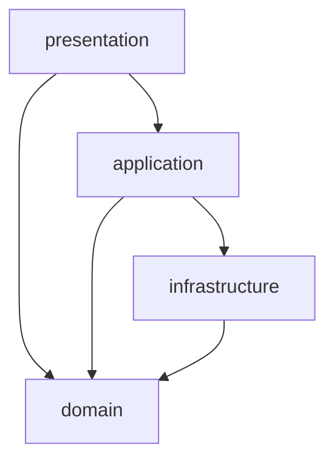

# B-backend-Fastapi

팀장님이 공유한 「처음 만나는 도메인 중심 4계층 아키텍처」 자료를 바탕으로 진행하는 FastAPI 백엔드 팀 프로젝트입니다. 5명이 도메인 모듈을 하나씩 맡아 구현합니다.

가게 예약 서비스 예시를 통해 **요청 받기 → 업무 규칙 확인 → DB 저장 → 결과 응답**의 흐름을 배우고 구현합니다.

> 현재는 구현 초기 단계입니다 (Docker PostgreSQL과 비동기 DB 연결까지 준비). 세부 설계는 [docs/](docs/)를 봅니다.

| 문서 | 내용 |
| --- | --- |
| [ARCHITECTURE](docs/ARCHITECTURE.md) | 모듈·계층 구조, ERD, 예약 규칙, API, 트랜잭션 |
| [BACKEND_PLAN](docs/BACKEND_PLAN.md) | 담당 1~5별 모듈·테이블·API·배울 것 |
| [ROADMAP](docs/ROADMAP.md) | 12일 일정과 체크포인트 |
| [WORKFLOW](docs/WORKFLOW.md) | 브랜치·리뷰·통합 방식 |
| [TEAM_CONVENTIONS](docs/TEAM_CONVENTIONS.md) | 코드·API·DB·테스트 규칙 |

## 프로젝트 목표

- FastAPI로 요청을 받고 올바른 응답을 반환합니다.
- 코드를 도메인 모듈로 나누고, 각 모듈을 4계층으로 나누어 책임을 분명히 합니다.
- 예약 규칙을 순수 파이썬 도메인 객체 안에 작성합니다.
- PostgreSQL에 비동기로 데이터를 저장하고, 예약과 좌석 변경을 한 트랜잭션으로 처리합니다.
- 로그인·로그아웃(토큰 차단)과 현재 사용자 확인, 역할·소유 기반 권한 확인을 구현합니다.
- 동작을 확인한 결과와 개발 중 해결한 문제를 기록해 발표 자료로 정리합니다.

## 사용할 기술

| 구분 | 사용 기술 |
| --- | --- |
| 언어와 환경 | Python 3.14, uv |
| API와 서버 실행 | FastAPI, Uvicorn |
| 데이터 검증 | Pydantic |
| 데이터 저장 | PostgreSQL 17 (Docker Compose), SQLAlchemy 비동기 ORM, asyncpg |
| 인증 | OAuth2 비밀번호 폼, JWT(PyJWT), passlib/bcrypt |
| 테스트 | pytest, httpx(`AsyncClient`) |

**비동기 DB 연결은 필수입니다.** 예약 생성에는 행 락을 넣고, 여러 요청이 같은 좌석을 동시에 예약하는 상황을 **실제로 재현해 검증하는 것은 선택 도전 기능**입니다.

**범위에서 뺀 것 (2026-10-28)**: UI(Jinja2 화면 포함), CI, Redis 캐시. API는 Swagger UI(`/docs`)와 pytest로 확인합니다.

## 가게 예약 도메인

| 대상 | 모듈 | 의미 |
| --- | --- | --- |
| `User` | `user` | 회원 정보 (손님 `CUSTOMER` / 운영자 `OWNER`) |
| `TokenBlacklist` | `user` | 로그아웃으로 사용을 막은 토큰 목록 |
| `Restaurant`, `Menu` | `restaurant` | 가게의 이름·분류·주소·운영 상태, 운영자(`owner_id`)와 메뉴 |
| `TimeSlot` | `slot` | 이용 시간, 총 수용 인원, 예약된 인원, 1회 최대 인원을 가진 시간대 |
| `Reservation` | `reservation` | 어느 회원이 어떤 시간대에 몇 명을 예약했는지 나타내는 내역 |

운영자는 별도 소속 테이블 없이 `restaurants.owner_id`로 가게와 연결합니다. 전체 ERD(테이블 6개)는 [ARCHITECTURE 3장](docs/ARCHITECTURE.md#3-데이터-모델-erd)에 있습니다.

주요 규칙:

- 이미 시작한 시간대에는 예약할 수 없습니다.
- 한 번에 예약할 수 있는 인원(`max_party_size`) 제한을 지킵니다.
- 잔여석보다 많은 인원을 예약할 수 없습니다.
- 같은 회원의 같은 시간대 중복 예약을 막습니다.
- 취소 시 좌석을 복구하고, 이미 취소한 예약을 다시 취소하지 못하게 합니다.

## 모듈과 4계층 구조

코드는 먼저 **도메인 모듈**(`user`, `restaurant`, `slot`, `reservation`, `owner`)로 나누고, 각 모듈 안을 4계층으로 나눕니다.

| 계층 | 쉬운 설명 | 주요 파일 |
| --- | --- | --- |
| `presentation` | 요청을 받고 입력을 확인하며 결과를 응답합니다. | `router.py`, `schemas.py` |
| `application` | 조회·규칙 실행·저장의 순서를 조율하고 저장을 확정합니다. | `service.py` |
| `domain` | 예약 가능 여부 같은 업무 규칙과 상태 변경을 담당합니다. | `time_slot.py`, `reservation.py`, `restaurant.py` |
| `infrastructure` | DB를 조회하고 도메인 객체로 변환하며 변경 내용을 저장합니다. | `models.py`, `repository.py` |



위 화살표는 **코드를 참조하는 방향**입니다.

- 도메인은 FastAPI·SQLAlchemy·Pydantic에 의존하지 않습니다. 파이썬 표준 라이브러리와 도메인 내부 코드는 사용할 수 있습니다.
- 레포지토리는 DB 모델을 순수 도메인 객체로 변환해 반환합니다.
- 서비스는 업무 규칙을 도메인에 맡기고, 여러 변경을 저장한 뒤 `commit()`으로 함께 확정합니다.
- 라우터는 업무 처리 결과와 예외를 API 응답으로 바꿉니다.
- 공통 DB 세션을 서비스에 전달하는 연결 코드는 허용하되, 라우터에 SQL과 업무 규칙을 모아 작성하지 않습니다.
- 모듈 사이에서 무엇을 가져다 쓸 수 있는지는 [ARCHITECTURE 2장](docs/ARCHITECTURE.md#모듈-사이-참조-규칙)을 따릅니다.

### 폴더 구조와 담당

```text
src/
├── main.py              # 앱 생성, lifespan(테이블 생성 + 시드), 미들웨어, 라우터 등록
├── common/              # DB 세션, 설정, 공통 에러 형식, Page[T], 미들웨어
├── user/                # 담당 1 강성수: 로그인 · 로그아웃 · 현재 사용자
│   ├── domain/
│   ├── application/
│   ├── infrastructure/
│   └── presentation/
├── restaurant/          # 담당 2 김태양: 식당 · 메뉴 (모듈마다 같은 4계층)
├── slot/                # 담당 3 이영민: 예약 시간대 · 예약 가능 조회 · 시드
├── reservation/         # 담당 4 김민지: 예약 생성·취소 / 담당 5 최지훈: 예약 조회
└── owner/               # 담당 5 최지훈: 운영자 권한 검사 · 운영자 조회 (자기 테이블 없음)
```

각 모듈·계층 패키지에 `__init__.py`를 포함합니다. 현재 저장소의 레이어 우선 골격(`src/domain/`, `src/infrastructure/database.py` 등)은 위 구조로 옮길 예정입니다.

## 예약 요청 하나가 처리되는 순서

예시 요청: `POST /api/v1/reservations`, 요청 데이터: `{"slot_id": 7, "party_size": 2}`

1. 라우터가 로그인 사용자와 입력 형식을 확인합니다.
2. 서비스가 시간대를 락 걸고 읽고, 같은 시간대의 기존 예약 여부를 레포지토리로 조회합니다.
3. 레포지토리가 DB 모델을 도메인 객체로 변환합니다.
4. 도메인이 시작 시각·인원·잔여석 규칙을 검사하고 좌석과 예약 상태를 변경합니다.
5. 레포지토리가 시간대와 예약 변경 내용을 저장합니다.
6. 서비스가 좌석 변경과 예약 생성을 하나의 트랜잭션으로 확정합니다.
7. 라우터가 성공 결과(201) 또는 오류(409 등)를 응답합니다.

API 응답은 Swagger UI(`/docs`)·Postman·curl로 확인합니다.

## 필수 구현 범위

| 항목 | 구현할 내용 |
| --- | --- |
| 구조와 업무 규칙 | 도메인 모듈별 4계층, 단방향 의존성, 순수 도메인 검증과 상태 변경 |
| DB와 저장 | 비동기 연결, ORM 모델과 도메인 변환, 서비스의 트랜잭션 제어, 행 락 |
| API | Pydantic 요청·응답 검증, 경로·쿼리 처리, 검색·필터·정렬·페이지네이션 |
| 예외 처리 | 잘못된 입력, 규칙 위반, 없는 대상에 맞는 공통 형식 오류 응답 |
| 인증과 보안 | 비밀번호 해시, OAuth2 로그인, JWT 발급, 로그아웃 토큰 차단(블랙리스트), 역할·소유 권한 확인 (계정은 시드) |
| 공통 처리 | CORS, 요청 로그와 처리 시간 기록 |
| 시작 데이터 | lifespan을 이용한 테이블 생성과 시연용 데이터 20건 이상, 재시작 시 중복 방지 |
| 문서와 발표 | 실행 안내, 구조도, 동작 캡처, 팀 기록과 발표 자료 |

## 선택 도전 기능

필수 기능을 완성한 뒤 팀에서 선택합니다.

- **A 동시성 제어 검증:** 동시에 요청이 몰리는 상황을 독립 DB 세션으로 재현하고, 행 락이 초과 예약을 막는지 확인합니다.
- **B 후속 작업과 다운로드:** `BackgroundTasks`로 후속 로그를 처리하고 `StreamingResponse`로 CSV를 내려받습니다.
- **C 회원가입:** 회원가입 API로 고객 계정을 만듭니다.

UI(Jinja2·React 등), CI, Redis 캐시, 예약 요청 중복 방지(멱등성)는 범위에서 제외합니다. 실제 결제 연동과 상용 메일·SMS 발송도 제외합니다. 외부 배포는 제출 조건일 때만 합니다.

## 큰 진행 순서

| 순서 | 할 일 | 남길 결과 |
| --- | --- | --- |
| 1 기획 | 주제와 핵심 기능, 예약·취소 규칙을 정합니다. | 서비스 소개와 규칙표 |
| 2 설계 | DB 관계, 모듈 경계, API 입력·응답을 정합니다. | ERD, API 명세 |
| 3 기본 구현 | 환경과 모듈 4계층을 준비하고 도메인·DB·레포지토리·서비스·API를 연결합니다. | 정상 처리와 규칙 위반 차단 |
| 4 기능 연결 | 인증, 목록 조회, 운영자 조회, 미들웨어를 연결합니다. | 전체 사용 흐름 |
| 5 동작 확인 | 정상·오류·인증 차단·저장 결과를 확인하고 필요한 선택 기능을 정합니다. | 결과 캡처와 문제 해결 기록 |
| 6 발표 준비 | README, 팀 노션과 발표 자료를 정리하고 시연을 연습합니다. | 실행 안내와 발표·시연 자료 |

## 공부와 개발 기록

- **데일리 기록:** 오늘 한 일, 다음 할 일, 막힌 점을 짧게 남깁니다.
- **개념 노트:** 새로 이해한 개념을 자기 말과 예시로 설명합니다.
- **문제 해결 기록:** 오류 원문, 재현 방법, 시도와 결과, 원인과 해결을 남깁니다.
- **확인 증거:** 실제로 확인한 응답·저장 결과를 캡처합니다.

이 기록을 모아 README, 팀 노션, 발표 자료를 만듭니다. 계획한 기능과 실제로 확인한 기능을 구분해 기록합니다.

## 실행 안내

1. 프로젝트 루트에 `.env`를 만들고 값을 채웁니다 (커밋하지 않음).

   ```text
   POSTGRES_USER=postgres
   POSTGRES_PASSWORD=<로컬 비밀번호>
   POSTGRES_DB=postgres
   POSTGRES_URL=postgresql+asyncpg://postgres:<로컬 비밀번호>@localhost:5432/postgres
   ```

2. PostgreSQL을 띄우고 의존성을 설치합니다.

   ```bash
   docker compose up -d
   ```

   ```bash
   uv sync
   ```

3. 앱을 실행합니다 (`src/main.py`가 준비된 뒤). 시작할 때 테이블과 시드가 자동으로 만들어집니다.

   ```bash
   uv run uvicorn main:app --app-dir src --reload
   ```

ORM 모델이 바뀌어 로컬 DB를 다시 만들어야 할 때는 `docker compose down -v` 후 다시 시작합니다.

## 참고 자료

- 팀장 공유 자료: 「처음 만나는 도메인 중심 4계층 아키텍처」
- [과제 발제문](https://app.notion.com/p/3b4578ecea3182558aae01eadd6b0e5d)
- [백엔드 교안](https://app.notion.com/p/558578ecea31829cb57101b5b80dda06)
- [백엔드 실습](https://app.notion.com/p/666578ecea3183b3a8fd8166f0bc2486)
