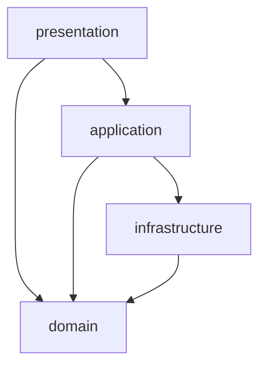

# B-backend-Fastapi

팀장님이 공유한 「처음 만나는 도메인 중심 4계층 아키텍처」 자료를 바탕으로 진행하는 FastAPI 백엔드 팀 프로젝트입니다.

가게 예약 서비스 예시를 통해 **요청 받기 → 업무 규칙 확인 → DB 저장 → 결과 응답**의 흐름을 배우고 구현합니다. 서비스의 세부 범위와 일정은 팀 협의로 정합니다.

> 현재는 시작 전이며, 이 README는 구현 계획입니다. 애플리케이션 코드와 실행 방법은 구현하면서 추가합니다.

## 프로젝트 목표

- FastAPI로 요청을 받고 올바른 응답을 반환합니다.
- 코드를 4계층으로 나누어 각 부분의 책임을 분명히 합니다.
- 예약 규칙을 순수 파이썬 도메인 객체 안에 작성합니다.
- PostgreSQL에 데이터를 저장하고, 예약과 좌석 변경을 함께 처리합니다.
- 로그인·로그아웃과 토큰 차단을 구현합니다.
- API와 Jinja2 웹 화면에서 같은 업무 기능을 사용합니다.
- 동작을 확인한 결과와 개발 중 해결한 문제를 기록해 발표 자료로 정리합니다.

## 사용할 기술

| 구분 | 사용 예정 기술 |
| --- | --- |
| 언어와 환경 | Python 3.13 이상, uv |
| API와 서버 실행 | FastAPI, Uvicorn |
| 데이터 검증 | Pydantic |
| 데이터 저장 | PostgreSQL, SQLAlchemy 비동기 ORM, asyncpg |
| 인증 | OAuth2, JWT, PyJWT, passlib/bcrypt |
| 웹 화면 | Jinja2, HTML, CSS, 정적 파일 |

**비동기 DB 연결은 필수입니다.** 여러 요청이 같은 좌석을 동시에 예약할 때 초과 예약을 막는 **동시성 제어는 선택 도전 기능**입니다.

## 자료의 가게 예약 예시

| 대상 | 의미 |
| --- | --- |
| `Restaurant` | 가게의 이름·분류·지역 정보 |
| `TimeSlot` | 이용 시간, 예약 오픈 시각, 정원과 예약 인원을 가진 시간대 |
| `Reservation` | 어느 회원이 어떤 시간대에 몇 명을 예약했는지 나타내는 내역 |
| `User` | 회원 정보 |
| `TokenBlacklist` | 로그아웃 등으로 사용을 막은 토큰 목록 |

예시에서 다루는 주요 규칙은 다음과 같습니다.

- 예약 오픈 시각 전과 이미 지난 시간대에는 예약할 수 없습니다.
- 한 번에 예약할 수 있는 인원 제한을 지킵니다.
- 잔여석보다 많은 인원을 예약할 수 없습니다.
- 같은 회원의 같은 시간대 중복 예약을 막습니다.
- 취소 시 좌석을 복구하고, 이미 취소한 예약을 다시 취소하지 못하게 합니다.

## 4계층 구조

| 계층 | 쉬운 설명 | 주요 파일 |
| --- | --- | --- |
| `presentation` | 요청을 받고 입력을 확인하며 결과를 응답합니다. | `router.py`, `schemas.py`, `web_router.py` |
| `application` | 조회·규칙 실행·저장의 순서를 조율하고 저장을 확정합니다. | `service.py` |
| `domain` | 예약 가능 여부 같은 업무 규칙과 상태 변경을 담당합니다. | `time_slot.py`, `reservation.py`, `restaurant.py` |
| `infrastructure` | DB를 조회하고 도메인 객체로 변환하며 변경 내용을 저장합니다. | `models.py`, `repositories.py` |



위 화살표는 **코드를 참조하는 방향**입니다.

- 도메인은 FastAPI·SQLAlchemy·Pydantic에 의존하지 않습니다. 파이썬 표준 라이브러리와 도메인 내부 코드는 사용할 수 있습니다.
- 레포지토리는 DB 모델을 순수 도메인 객체로 변환해 반환합니다.
- 서비스는 업무 규칙을 도메인에 맡기고, 여러 변경을 저장한 뒤 `commit()`으로 함께 확정합니다.
- 라우터는 업무 처리 결과와 예외를 API 응답 또는 웹 화면 메시지로 바꿉니다.
- 공통 DB 세션을 서비스에 전달하는 연결 코드는 허용하되, 라우터에 SQL과 업무 규칙을 모아 작성하지 않습니다.

### 예정 폴더 구조

```text
src/
├── main.py                  # 앱 시작·종료, 라우터와 미들웨어 연결
├── database.py              # 비동기 DB 엔진과 세션
├── templates/               # Jinja2 화면
├── static/                  # CSS와 이미지
├── auth/                    # 인증 기능도 같은 4계층으로 구성
│   ├── domain/
│   ├── application/
│   ├── infrastructure/
│   └── presentation/
└── reservation/
    ├── domain/              # 예약 규칙과 상태 변경
    ├── application/         # 예약·취소 처리 순서
    ├── infrastructure/      # DB 모델과 레포지토리
    └── presentation/        # API·입출력 스키마·웹 라우터
```

각 기능·계층 패키지에 `__init__.py`를 포함합니다. 위 구조는 앞으로 만들 계획이며 현재 구현 상태를 나타내지 않습니다.

## 예약 요청 하나가 처리되는 순서

자료의 예시 요청: `POST /slots/7/reservations`, 요청 데이터: `{"party_size": 2}`

1. 라우터가 로그인 사용자와 입력 형식을 확인합니다.
2. 서비스가 시간대 정보와 기존 예약 여부를 레포지토리로 조회합니다.
3. 레포지토리가 DB 모델을 도메인 객체로 변환합니다.
4. 도메인이 중복·오픈 시각·인원·잔여석 규칙을 검사하고 예약 상태를 변경합니다.
5. 레포지토리가 시간대와 예약 변경 내용을 저장합니다.
6. 서비스가 좌석 변경과 예약 생성을 하나의 트랜잭션으로 확정합니다.
7. 라우터가 성공 결과 또는 오류를 응답합니다.

API 라우터와 Jinja2 웹 라우터는 같은 서비스를 사용합니다. API 응답은 Swagger UI·Postman·curl로 확인하고, 웹 화면은 브라우저에서 확인합니다.

## 필수 구현 범위

| 항목 | 구현할 내용 |
| --- | --- |
| 구조와 업무 규칙 | 기능별 4계층, 단방향 의존성, 순수 도메인 검증과 상태 변경 |
| DB와 저장 | 비동기 연결, ORM 모델과 도메인 변환, 서비스의 트랜잭션 제어 |
| API | Pydantic 요청·응답 검증, 경로·쿼리 처리, 검색·필터·정렬·페이지네이션 |
| 예외 처리 | 잘못된 입력, 규칙 위반, 없는 대상에 맞는 오류 응답 |
| 인증과 보안 | 회원가입, 비밀번호 해시, OAuth2 로그인, JWT 발급, 로그아웃 토큰 차단 |
| 공통 처리 | CORS, 요청 로그와 처리 시간 기록 |
| 웹 화면 | Jinja2와 정적 파일로 실제 DB 데이터의 목록·현황 표시 |
| 시작 데이터 | lifespan을 이용한 테이블 생성과 시연용 데이터 20건 이상, 재시작 시 중복 방지 |
| 문서와 발표 | 실행 안내, 구조도, 동작 캡처, 팀 기록과 발표 자료 |

## 선택 도전 기능

필수 기능을 완성한 뒤 팀에서 선택합니다.

- **A 동시성 제어:** 동시에 요청이 몰리는 상황을 재현하고 DB 잠금 등으로 초과 예약을 방어합니다.
- **B 후속 작업과 다운로드:** `BackgroundTasks`로 후속 로그를 처리하고 `StreamingResponse`로 CSV를 내려받습니다.
- **C 캐싱과 배포:** 조회 결과를 잠시 재사용하고 데이터 변경 시 갱신하며, 외부 실행 환경을 구성합니다.

실제 결제 연동과 상용 메일·SMS 발송은 과제 범위에서 제외합니다. 웹 화면은 Jinja2로 구성하며 별도 React·Next.js 화면 구축은 진행 범위에 포함하지 않습니다.

## 큰 진행 순서

| 순서 | 할 일 | 남길 결과 |
| --- | --- | --- |
| 1 기획 | 주제와 핵심 기능, 예약·취소 규칙을 정합니다. | 서비스 소개와 규칙표 |
| 2 설계 | DB 관계, API 입력·응답, 웹 화면 구성을 정합니다. | ERD, API 명세, 화면 초안 |
| 3 기본 구현 | 환경과 4계층을 준비하고 도메인·DB·레포지토리·서비스·API를 연결합니다. | 정상 처리와 규칙 위반 차단 |
| 4 기능 연결 | 회원 인증, 목록 조회, Jinja2 화면과 미들웨어를 연결합니다. | 전체 사용 흐름 |
| 5 동작 확인 | 정상·오류·인증 차단·저장 결과를 확인하고 필요한 선택 기능을 정합니다. | 결과 캡처와 문제 해결 기록 |
| 6 발표 준비 | README, 팀 노션과 발표 자료를 정리하고 시연을 연습합니다. | 실행 안내와 발표·시연 자료 |

## 공부와 개발 기록

- **데일리 기록:** 오늘 한 일, 다음 할 일, 막힌 점을 짧게 남깁니다.
- **개념 노트:** 새로 이해한 개념을 자기 말과 예시로 설명합니다.
- **문제 해결 기록:** 오류 원문, 재현 방법, 시도와 결과, 원인과 해결을 남깁니다.
- **확인 증거:** 실제로 확인한 화면·응답·저장 결과를 캡처합니다.

이 기록을 모아 README, 팀 노션, 발표 자료를 만듭니다. 계획한 기능과 실제로 확인한 기능을 구분해 기록합니다.

## 실행 안내

현재는 애플리케이션 코드와 `pyproject.toml`이 없는 시작 전 단계입니다. 구현 후 팀 공통 실행 절차와 환경변수 설정 방법을 이곳에 추가합니다.

팀장 자료와 수업의 예정 실행 명령은 다음과 같으며, 앱과 의존성·DB 구성이 준비된 뒤 사용합니다.

```bash
uv run uvicorn main:app --app-dir src --reload
```

## 참고 자료

- 팀장 공유 자료: 「처음 만나는 도메인 중심 4계층 아키텍처」
- [과제 발제문](https://app.notion.com/p/3b4578ecea3182558aae01eadd6b0e5d)
- [백엔드 교안](https://app.notion.com/p/558578ecea31829cb57101b5b80dda06)
- [백엔드 실습](https://app.notion.com/p/666578ecea3183b3a8fd8166f0bc2486)
