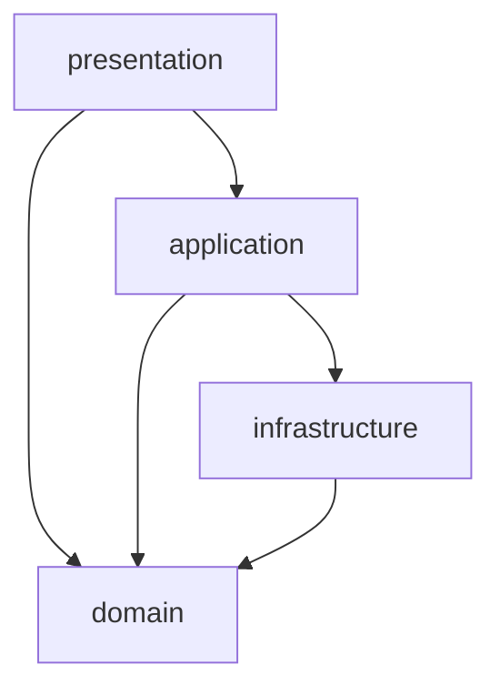

# B-backend-Fastapi

「처음 만나는 도메인 중심 4계층 아키텍처」 자료를 바탕으로 만든 **식당 예약 서비스** FastAPI 백엔드 팀 프로젝트입니다. 5명이 도메인 모듈을 하나씩 맡아 구현했습니다.

손님 예약, 운영자 예약 관리, 관리자 식당·예약 조회를 **요청 받기 → 업무 규칙 확인 → DB 저장 → 결과 응답**의 흐름으로 구현합니다.

## 시연 영상

https://github.com/user-attachments/assets/34e192ff-7359-48f8-abd9-4d0580655602

왼쪽은 화면(Jinja2)·API 호출, 오른쪽은 실시간 서버 로그입니다 (약 1분 40초).

- **손님:** 회원가입 → 식당 고르기 → 날짜·인원·시간 선택 예약, 같은 시간 중복 예약은 `409`로 거절
- **운영자:** 내 식당 예약 목록에서 입장·노쇼·취소 처리, 메뉴 등록·수정·삭제, 예약 CSV 내려받기
- **관리자·오류 처리:** 관리자 취소, 권한 없는 접근 `401`/`403`, 입력 오류 `422`, 없는 식당 `404`, 로그인 시도 제한 `429`

| 문서 | 내용 |
| --- | --- |
| [ARCHITECTURE](docs/ARCHITECTURE.md) | 모듈·계층 구조, ERD, 예약 규칙, API, 트랜잭션 |
| [API_SPEC](docs/API_SPEC.md) | API 명세, 공통 응답·에러 형식 |
| [JINJA2_TEMPLATE_GUIDE](docs/JINJA2_TEMPLATE_GUIDE.md) | Jinja2 화면과 코드 |
| [TEAM_CONVENTIONS](docs/TEAM_CONVENTIONS.md) | 코드·API·DB·테스트 규칙 |
| [시연 환경 준비](demo/README.md) · [시연 순서](demo/SCENARIO.md) | 시연 데이터·서버 로그 창 실행, 발표 흐름 |

## 프로젝트 목표

- FastAPI로 요청을 받고 올바른 응답을 반환합니다.
- 코드를 도메인 모듈로 나누고, 각 모듈을 4계층으로 나누어 책임을 분명히 합니다.
- 예약 규칙을 순수 파이썬 도메인 객체 안에 작성합니다.
- PostgreSQL에 비동기로 데이터를 저장하고, 예약과 좌석 변경을 한 트랜잭션으로 처리합니다.
- 로그인·로그아웃(토큰 차단)과 현재 사용자 확인, 역할·소유 기반 권한 확인을 구현합니다.

## 사용 기술

| 구분 | 사용 기술 |
| --- | --- |
| 언어와 환경 | Python 3.14, uv |
| API와 서버 실행 | FastAPI, Uvicorn |
| 데이터 검증 | Pydantic |
| 데이터 저장 | PostgreSQL 17 (Docker Compose), SQLAlchemy 비동기 ORM, asyncpg |
| 인증 | OAuth2 비밀번호 폼, JWT(PyJWT), bcrypt |
| 화면 | Jinja2 템플릿 |
| 테스트 | pytest, pytest-asyncio, httpx(`AsyncClient`) |
| 코드 검사 | ruff |

프론트 프레임워크(React 등), CI, Redis 캐시, 실제 결제·메일·SMS 연동은 범위에서 제외했습니다. API는 Swagger UI(`/docs`)와 pytest로 확인합니다.

## 가게 예약 도메인

| 대상 | 모듈 | 의미 |
| --- | --- | --- |
| `User` | `user` | 회원 정보 (손님 `CUSTOMER` / 운영자 `OWNER` / 관리자 `ADMIN`, 관리자는 시드로만) |
| `TokenBlacklist` | `auth` | 로그아웃으로 사용을 막은 토큰 목록 |
| `Restaurant`, `Menu` | `restaurant` | 가게의 이름·분류·주소, 운영자(`owner_id`)와 메뉴 |
| `TimeSlot` | `slot` | 이용 시간, 총 수용 인원, 예약된 인원, 1회 최대 인원을 가진 시간대 |
| `Reservation` | `reservation` | 어느 회원이 어떤 시간대에 몇 명을 예약했는지 나타내는 내역 |

운영자는 별도 소속 테이블 없이 `restaurants.owner_id`로 가게와 연결합니다. 사용자 id는 UUID, 나머지 테이블 id는 BIGINT입니다. 전체 ERD(테이블 6개)는 [ARCHITECTURE 3장](docs/ARCHITECTURE.md#3-데이터-모델-erd)에 있습니다.

주요 규칙:

- 이미 시작한 시간대에는 예약할 수 없습니다.
- 한 번에 예약할 수 있는 인원(`max_party_size`) 제한을 지킵니다.
- 잔여석보다 많은 인원을 예약할 수 없습니다.
- 같은 회원의 같은 시간대 중복 예약을 막습니다.
- 시작 전 취소 시 예약 인원만큼 좌석을 복구하고, 이미 취소한 예약을 다시 취소하지 못하게 합니다.

## 모듈과 4계층 구조

코드는 먼저 **도메인 모듈**(`auth`, `user`, `restaurant`, `slot`, `reservation`, `owner`)로 나누고, 각 모듈 안을 4계층으로 나눕니다.

| 계층 | 쉬운 설명 | 주요 파일 |
| --- | --- | --- |
| `presentation` | 요청을 받고 입력을 확인하며 결과를 응답합니다. | `router.py`, `schemas.py` |
| `application` | 조회·규칙 실행·저장의 순서를 조율하고 저장을 확정합니다. | `service.py` |
| `domain` | 예약 가능 여부 같은 업무 규칙과 상태 변경을 담당합니다. | `time_slot.py`, `reservation.py`, `restaurant.py` |
| `infrastructure` | DB를 조회하고 도메인 객체로 변환하며 변경 내용을 저장합니다. | `models.py`, `repository.py`(또는 `repositories.py`) |



위 화살표는 **코드를 참조하는 방향**입니다.

- 도메인은 FastAPI·SQLAlchemy·Pydantic에 의존하지 않습니다. 파이썬 표준 라이브러리와 도메인 내부 코드는 사용할 수 있습니다.
- 레포지토리는 DB 모델을 순수 도메인 객체로 변환해 반환합니다.
- 서비스는 업무 규칙을 도메인에 맡기고, 여러 변경을 저장한 뒤 `commit()`으로 함께 확정합니다.
- 라우터는 업무 처리 결과와 예외를 API 응답으로 바꿉니다.
- 로그인한 사용자는 `Depends(get_authenticated_user)`로 받은 `AuthenticatedUser`(`user_id`, `role`)로 다룹니다.
- 모듈 사이에서 무엇을 가져다 쓸 수 있는지는 [ARCHITECTURE 2장](docs/ARCHITECTURE.md#모듈-사이-참조-규칙)을 따릅니다.

### 폴더 구조와 담당

```text
src/
├── main.py              # 앱 생성, lifespan(테이블 생성 + 시드), 미들웨어, 라우터 등록
├── common/              # DB 세션, ORM Base, 설정, 공통 에러 형식, Page[T], 미들웨어
├── auth/                # 담당 1 강성수: 로그인 · 로그아웃 · 현재 사용자 의존성
├── user/                # 담당 1 강성수: 회원가입 · 역할 변경 · 내 정보 조회
│   ├── domain/
│   ├── application/
│   ├── infrastructure/
│   └── presentation/
├── restaurant/          # 담당 2 김태양: 식당 · 메뉴 (모듈마다 같은 4계층)
├── slot/                # 담당 3 이영민: 예약 시간대 · 예약 가능 조회 · 시드
├── reservation/         # 담당 4 김민지: 예약 생성·취소 / 담당 5 최지훈: 예약 조회
├── owner/               # 담당 5 최지훈: 운영자 권한 검사 · 운영자 조회 (자기 테이블 없음)
├── browse/              # 담당 5 최지훈: 손님 식당 둘러보기 조회 (화면 전용)
├── admin/               # 담당 5 최지훈: 관리자 조회 (화면 전용, domain 없음)
├── web.py               # 담당 5 최지훈: Jinja2 화면 라우터 /ui (손님·운영자·관리자)
├── web_auth.py          # 담당 5 최지훈: 화면 로그인 (JWT를 HttpOnly 쿠키에)
├── web_data.py          # 담당 5 최지훈: 화면 ↔ 운영자 매니저 연결
├── seed.py              # 담당 3 이영민: 시드 (lifespan에서 한 번)
├── templates/           # 담당 5 최지훈: HTML 템플릿 (base + components include)
└── static/              # 담당 5 최지훈: CSS
demo/                    # 담당 5 최지훈: 시연 앱 (서버 로그 창·계정 바꾸기·시간대 채우기)
```

## 예약 요청 하나가 처리되는 순서

예시 요청: `POST /api/v1/reservations`, 요청 데이터: `{"slot_id": 7, "party_size": 2}`

1. 라우터가 로그인 사용자와 입력 형식을 확인합니다.
2. 서비스가 시간대를 락 걸고 읽고, 같은 시간대의 기존 예약 여부를 레포지토리로 조회합니다.
3. 레포지토리가 DB 모델을 도메인 객체로 변환합니다.
4. 도메인이 시작 시각·인원·잔여석 규칙을 검사하고 좌석과 예약 상태를 변경합니다.
5. 레포지토리가 시간대와 예약 변경 내용을 저장합니다.
6. 서비스가 좌석 변경과 예약 생성을 하나의 트랜잭션으로 확정합니다. 락 대기가 길어지면(기본 3초) 트랜잭션을 끊고 오류로 응답합니다.
7. 라우터가 성공 결과(201) 또는 오류(409 등)를 응답합니다.

## 구현 범위

| 항목 | 구현 내용 |
| --- | --- |
| 구조와 업무 규칙 | 도메인 모듈별 4계층, 단방향 의존성, 순수 도메인 검증과 상태 변경 |
| DB와 저장 | 비동기 연결, ORM 모델과 도메인 변환, 서비스의 트랜잭션 제어, 행 락 |
| API | Pydantic 요청·응답 검증, 경로·쿼리 처리, 검색·필터·정렬·페이지네이션 |
| 예외 처리 | 잘못된 입력, 규칙 위반, 없는 대상에 맞는 공통 형식 오류 응답 |
| 인증과 보안 | 비밀번호 해시, OAuth2 로그인, JWT 발급, 로그아웃 토큰 차단, 로그인 시도 제한, 역할·소유 권한 확인, 손님 회원가입 |
| 공통 처리 | CORS, 요청 로그와 처리 시간 기록 |
| 시작 데이터 | lifespan을 이용한 테이블 생성과 시연용 시드, 재시작 시 중복 방지 |

### 화면 (Jinja2)

| 역할 | 주소 | 할 수 있는 일 |
| --- | --- | --- |
| 공통 | `/ui`, `/ui/signup` | 로그인(JWT를 HttpOnly 쿠키에, 로그아웃 시 토큰 차단), 회원가입. `/`는 식당 둘러보기로 이동 |
| 손님 | `/ui/restaurants` | 이름·메뉴·주소 검색, 음식 종류·구·동 필터, 10개씩 보기. 상세(대표 사진·메뉴)에서 날짜·인원·시간을 골라 예약 |
| 손님 | `/ui/my/reservations` | 내 예약 확인과 취소 |
| 운영자 | `/ui/owner/restaurants` | 내 식당 목록, 식당별 예약(예약자 이름)에서 입장·노쇼·이유를 고르는 취소 |
| 관리자 | `/ui/admin/owners` | 운영자 목록 → 식당 → 예약+예약자, 이유+메모를 남기는 취소 |

### 선택 도전 기능

- **A 동시성 제어 검증:** 독립 DB 세션으로 동시 요청을 재현해, 행 락이 초과 예약과 중복 취소를 막는지 테스트로 확인합니다 (`tests/reservation/test_reservation_db.py`).
- **B 후속 작업과 다운로드:** 운영자 식당 예약을 `StreamingResponse`로 CSV 내려받기, `BackgroundTasks`로 응답 뒤 로그 처리.
- **C 회원가입:** 회원가입 API와 화면으로 손님 계정을 만듭니다.

## 실행 안내

1. 프로젝트 루트에 `.env`를 만들고 값을 채웁니다 (커밋하지 않음).

   ```text
   POSTGRES_USER=postgres
   POSTGRES_PASSWORD=<로컬 비밀번호>
   POSTGRES_DB=postgres
   POSTGRES_URL=postgresql+asyncpg://postgres:<로컬 비밀번호>@localhost:5432/postgres
   # 로그인 토큰 서명 열쇠. 없거나 64바이트보다 짧으면 로그인 때 에러
   JWT_SECRET_KEY=<64바이트 이상 무작위 문자열>
   # 선택: 허용할 프론트 주소 (쉼표 구분, 기본값 http://localhost:3000)
   CORS_ORIGINS=http://localhost:3000
   ```

2. PostgreSQL을 띄우고 의존성을 설치합니다.

   ```bash
   docker compose up -d
   ```

   ```bash
   uv sync
   ```

   설치가 끝나면 아래 명령으로 `JWT_SECRET_KEY` 값을 만들어 `.env`에 넣습니다.

   ```bash
   uv run python -c "import secrets; print(secrets.token_urlsafe(64))"
   ```

3. 앱을 실행합니다. 시작할 때 lifespan이 테이블을 만들고, DB가 비어 있으면 시드를 넣습니다.

   ```bash
   uv run uvicorn main:app --app-dir src --reload
   ```

   시연할 때는 화면 옆에 서버 로그 창을 붙여서 켭니다 (저장소 맨 위 폴더에서, 자세한 내용은 [시연 환경 준비](demo/README.md)).

   ```bash
   uv run uvicorn demo.log_panel_app:app
   ```

   화면: `http://127.0.0.1:8000/ui` · API 문서: `http://127.0.0.1:8000/docs`

4. 테스트를 돌립니다 (`pyproject.toml`에 `src` 경로와 비동기 모드가 설정되어 있음).

   ```bash
   uv run pytest
   ```

`docker compose down -v`는 DB 볼륨과 저장 데이터를 삭제합니다. 사진·주소만 갱신할 때는 [CSV 갱신 명령](demo/README.md)을 사용합니다.

## 참고 자료

- 팀장 공유 자료: 「처음 만나는 도메인 중심 4계층 아키텍처」
- [과제 발제문](https://app.notion.com/p/3b4578ecea3182558aae01eadd6b0e5d)
- [백엔드 교안](https://app.notion.com/p/558578ecea31829cb57101b5b80dda06)
- [백엔드 실습](https://app.notion.com/p/666578ecea3183b3a8fd8166f0bc2486)
