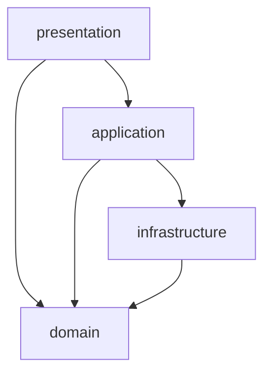

# B-backend-Fastapi

팀장님이 공유한 「처음 만나는 도메인 중심 4계층 아키텍처」 자료를 바탕으로 진행하는 FastAPI 백엔드 팀 프로젝트입니다. 5명이 도메인 모듈을 하나씩 맡아 구현합니다.

가게 예약 서비스 예시를 통해 **요청 받기 → 업무 규칙 확인 → DB 저장 → 결과 응답**의 흐름을 배우고 구현합니다.

> 현재는 **4 기능 연결** 단계입니다 (2026-11-09, PR #37까지). 지금까지 들어온 것과 다음에 할 일은 [지금 어디까지 왔나](#지금-어디까지-왔나-2026-11-09-pr-37까지)를 봅니다. 세부 설계는 [docs/](docs/)를 봅니다.

| 문서 | 내용 |
| --- | --- |
| [ARCHITECTURE](docs/ARCHITECTURE.md) | 모듈·계층 구조, ERD, 예약 규칙, API, 트랜잭션 |
| [API_SPEC](docs/API_SPEC.md) | API 명세 작성 기준, 공통 응답·에러 형식, 템플릿 |
| [BACKEND_PLAN](docs/BACKEND_PLAN.md) | 담당 1~5별 모듈·테이블·API·배울 것 |
| [ROADMAP](docs/ROADMAP.md) | 12일 일정과 체크포인트 |
| [WORKFLOW](docs/WORKFLOW.md) | 브랜치·리뷰·통합 방식 |
| [TEAM_CONVENTIONS](docs/TEAM_CONVENTIONS.md) | 코드·API·DB·테스트 규칙 |

## 프로젝트 목표

- FastAPI로 요청을 받고 올바른 응답을 반환합니다.
- 코드를 도메인 모듈로 나누고, 각 모듈을 4계층으로 나누어 책임을 분명히 합니다.
- 예약 규칙을 순수 파이썬 도메인 객체 안에 작성합니다.
- PostgreSQL에 비동기로 데이터를 저장하고, 예약과 좌석 변경을 한 트랜잭션으로 처리합니다.
- 로그인·로그아웃(토큰 차단)과 현재 사용자 확인, 역할·소유 기반 권한 확인을 구현합니다.
- 동작을 확인한 결과와 개발 중 해결한 문제를 기록해 발표 자료로 정리합니다.

## 사용할 기술

| 구분 | 사용 기술 |
| --- | --- |
| 언어와 환경 | Python 3.14, uv |
| API와 서버 실행 | FastAPI, Uvicorn |
| 데이터 검증 | Pydantic |
| 데이터 저장 | PostgreSQL 17 (Docker Compose), SQLAlchemy 비동기 ORM, asyncpg |
| 인증 | OAuth2 비밀번호 폼, JWT(PyJWT), bcrypt |
| 테스트 | pytest, pytest-asyncio, httpx(`AsyncClient`) |
| 코드 검사 | ruff |
| 화면 | Jinja2 템플릿 (담당 5, #17에서 설치) |

**비동기 DB 연결은 필수입니다.** 예약 생성에는 행 락을 넣고, 여러 요청이 같은 좌석을 동시에 예약하는 상황을 **실제로 재현해 검증하는 것은 선택 도전 기능**입니다.

**범위에서 뺀 것 (2026-10-28)**: 프론트 연결(React 등), CI, Redis 캐시. API는 Swagger UI(`/docs`)와 pytest로 확인합니다. **Jinja2 화면은 2026-11-02 회의에서 다시 넣었습니다** (담당 5: 식당 목록·상세).

## 가게 예약 도메인

| 대상 | 모듈 | 의미 |
| --- | --- | --- |
| `User` | `user` | 회원 정보 (손님 `CUSTOMER` / 운영자 `OWNER` / 관리자 `ADMIN`, 관리자는 시드로만) |
| `TokenBlacklist` | `auth` | 로그아웃으로 사용을 막은 토큰 목록 |
| `Restaurant`, `Menu` | `restaurant` | 가게의 이름·분류·주소·운영 상태, 운영자(`owner_id`)와 메뉴 |
| `TimeSlot` | `slot` | 이용 시간, 총 수용 인원, 예약된 인원, 1회 최대 인원을 가진 시간대 |
| `Reservation` | `reservation` | 어느 회원이 어떤 시간대에 몇 명을 예약했는지 나타내는 내역 |

운영자는 별도 소속 테이블 없이 `restaurants.owner_id`로 가게와 연결합니다. 전체 ERD(테이블 6개)는 [ARCHITECTURE 3장](docs/ARCHITECTURE.md#3-데이터-모델-erd)에 있습니다.

주요 규칙:

- 이미 시작한 시간대에는 예약할 수 없습니다.
- 한 번에 예약할 수 있는 인원(`max_party_size`) 제한을 지킵니다.
- 잔여석보다 많은 인원을 예약할 수 없습니다.
- 같은 회원의 같은 시간대 중복 예약을 막습니다.
- 취소 시 좌석을 복구하고, 이미 취소한 예약을 다시 취소하지 못하게 합니다.

## 모듈과 4계층 구조

코드는 먼저 **도메인 모듈**(`auth`, `user`, `restaurant`, `slot`, `reservation`, `owner`)로 나누고, 각 모듈 안을 4계층으로 나눕니다.

| 계층 | 쉬운 설명 | 주요 파일 |
| --- | --- | --- |
| `presentation` | 요청을 받고 입력을 확인하며 결과를 응답합니다. | `router.py`, `schemas.py` |
| `application` | 조회·규칙 실행·저장의 순서를 조율하고 저장을 확정합니다. | `service.py` |
| `domain` | 예약 가능 여부 같은 업무 규칙과 상태 변경을 담당합니다. | `time_slot.py`, `reservation.py`, `restaurant.py` |
| `infrastructure` | DB를 조회하고 도메인 객체로 변환하며 변경 내용을 저장합니다. | `models.py`, `repository.py`(또는 `repositories.py`) |



위 화살표는 **코드를 참조하는 방향**입니다.

- 도메인은 FastAPI·SQLAlchemy·Pydantic에 의존하지 않습니다. 파이썬 표준 라이브러리와 도메인 내부 코드는 사용할 수 있습니다.
- 레포지토리는 DB 모델을 순수 도메인 객체로 변환해 반환합니다.
- 서비스는 업무 규칙을 도메인에 맡기고, 여러 변경을 저장한 뒤 `commit()`으로 함께 확정합니다.
- 라우터는 업무 처리 결과와 예외를 API 응답으로 바꿉니다.
- 공통 DB 세션을 서비스에 전달하는 연결 코드는 허용하되, 라우터에 SQL과 업무 규칙을 모아 작성하지 않습니다.
- 모듈 사이에서 무엇을 가져다 쓸 수 있는지는 [ARCHITECTURE 2장](docs/ARCHITECTURE.md#모듈-사이-참조-규칙)을 따릅니다.

### 폴더 구조와 담당

```text
src/
├── main.py              # 앱 생성, lifespan(테이블 생성 + 시드), 미들웨어, 라우터 등록
├── common/              # DB 세션, ORM Base(model.py), 설정, 공통 에러 형식, Page[T], 미들웨어
├── auth/                # 담당 1 강성수: 로그인 · 로그아웃 · 현재 사용자 의존성
├── user/                # 담당 1 강성수: 회원가입 · 역할 변경 · 내 정보 조회(예정)
│   ├── domain/
│   ├── application/
│   ├── infrastructure/
│   └── presentation/
├── restaurant/          # 담당 2 김태양: 식당 · 메뉴 (모듈마다 같은 4계층)
├── slot/                # 담당 3 이영민: 예약 시간대 · 예약 가능 조회 · 시드
├── reservation/         # 담당 4 김민지: 예약 생성·취소 / 담당 5 최지훈: 예약 조회
├── owner/               # 담당 5 최지훈: 운영자 권한 검사 · 운영자 조회 (자기 테이블 없음)
├── browse/              # 담당 5 최지훈: 손님 식당 둘러보기 조회 (구·동·음식 종류, 이름·메뉴·주소 검색, 화면 전용)
├── admin/               # 담당 5 최지훈: 관리자 조회 (운영자+식당 수, 예약+예약자, 화면 전용, domain 없음)
├── web.py               # 담당 5 최지훈: Jinja2 화면 라우터 /ui (손님·운영자·관리자)
├── web_auth.py          # 담당 5 최지훈: 화면 로그인 (JWT를 HttpOnly 쿠키에, 담당 1 AuthService 사용)
├── web_data.py          # 담당 5 최지훈: 화면 ↔ 운영자 매니저 연결
├── seed.py              # 담당 3 이영민: 시드 (lifespan에서 한 번)
├── templates/           # 담당 5 최지훈: HTML 템플릿 (base + components include)
└── static/              # 담당 5 최지훈: CSS
demo/                    # 담당 5 최지훈: 시연 앱 (서버 로그 창·계정 바꾸기·시간대 채우기, 팀 앱을 감싸서 켬, src/는 안 고침)
```

각 모듈·계층 패키지에 `__init__.py`를 포함합니다. 처음의 레이어 우선 골격은 위 모듈 구조로 옮겼습니다 (`src/common/database.py`).

## 예약 요청 하나가 처리되는 순서

예시 요청: `POST /api/v1/reservations`, 요청 데이터: `{"slot_id": 7, "party_size": 2}`

1. 라우터가 로그인 사용자와 입력 형식을 확인합니다.
2. 서비스가 시간대를 락 걸고 읽고, 같은 시간대의 기존 예약 여부를 레포지토리로 조회합니다.
3. 레포지토리가 DB 모델을 도메인 객체로 변환합니다.
4. 도메인이 시작 시각·인원·잔여석 규칙을 검사하고 좌석과 예약 상태를 변경합니다.
5. 레포지토리가 시간대와 예약 변경 내용을 저장합니다.
6. 서비스가 좌석 변경과 예약 생성을 하나의 트랜잭션으로 확정합니다.
7. 라우터가 성공 결과(201) 또는 오류(409 등)를 응답합니다.

API 응답은 Swagger UI(`/docs`)·Postman·curl로 확인합니다.

## 필수 구현 범위

| 항목 | 구현할 내용 |
| --- | --- |
| 구조와 업무 규칙 | 도메인 모듈별 4계층, 단방향 의존성, 순수 도메인 검증과 상태 변경 |
| DB와 저장 | 비동기 연결, ORM 모델과 도메인 변환, 서비스의 트랜잭션 제어, 행 락 |
| API | Pydantic 요청·응답 검증, 경로·쿼리 처리, 검색·필터·정렬·페이지네이션 |
| 예외 처리 | 잘못된 입력, 규칙 위반, 없는 대상에 맞는 공통 형식 오류 응답 |
| 인증과 보안 | 비밀번호 해시, OAuth2 로그인, JWT 발급, 로그아웃 토큰 차단(블랙리스트), 역할·소유 권한 확인 (계정은 시드) |
| 공통 처리 | CORS, 요청 로그와 처리 시간 기록 |
| 화면 | Jinja2 템플릿 화면 (담당 5, #48·#50·이번 PR). 손님: 식당 둘러보기 `/ui/restaurants`(이름·메뉴·주소 전체 검색, 음식 종류·구·동, 10개씩), 상세(대표 사진·메뉴)에서 날짜·인원·시간 골라 예약, 내 예약 `/ui/my/reservations`에서 취소, 회원가입 `/ui/signup`. 운영자: 내 식당 `/ui/owner/restaurants`, 식당 예약 `.../{id}/reservations`(예약자 이름, 입장·노쇼·이유 고르는 취소). 관리자: 운영자 목록 `/ui/admin/owners` → 식당 → 예약+예약자(이유+메모 취소). 로그인 `/ui`(JWT를 HttpOnly 쿠키에, 로그아웃 시 토큰 차단). `/`는 식당 둘러보기로 |
| 시작 데이터 | lifespan을 이용한 테이블 생성과 시연용 데이터 20건 이상, 재시작 시 중복 방지 |
| 문서와 발표 | 실행 안내, 구조도, 동작 캡처, 팀 기록과 발표 자료 |

## 선택 도전 기능

필수 기능을 완성한 뒤 팀에서 선택합니다.

- **A 동시성 제어 검증:** 동시에 요청이 몰리는 상황을 독립 DB 세션으로 재현하고, 행 락이 초과 예약을 막는지 확인합니다. 예약 생성·취소 매니저에 행 락은 들어갔고(#37), 동시 요청 재현은 아직입니다.
- **B 후속 작업과 다운로드:** `BackgroundTasks`로 후속 로그를 처리하고 `StreamingResponse`로 CSV를 내려받습니다. **완료 (#34)**: 운영자 식당 예약 CSV 내려받기 + 응답 뒤 로그.
- **C 회원가입:** 회원가입 API로 고객 계정을 만듭니다.

프론트 연결(React 등), CI, Redis 캐시, 예약 요청 중복 방지(멱등성)는 범위에서 제외합니다. Jinja2 화면은 필수 범위에 넣었습니다 (2026-11-02). 실제 결제 연동과 상용 메일·SMS 발송도 제외합니다. 외부 배포는 제출 조건일 때만 합니다.

## 큰 진행 순서

| 순서 | 할 일 | 남길 결과 | 지금 (11/9) |
| --- | --- | --- | --- |
| 1 기획 | 주제와 핵심 기능, 예약·취소 규칙을 정합니다. | 서비스 소개와 규칙표 | 완료 |
| 2 설계 | DB 관계, 모듈 경계, API 입력·응답을 정합니다. | ERD, API 명세 | 완료 |
| 3 기본 구현 | 환경과 모듈 4계층을 준비하고 도메인·DB·레포지토리·서비스·API를 연결합니다. | 정상 처리와 규칙 위반 차단 | 거의 완료 (모든 모듈의 도메인 규칙·표·창고, 예약 생성·취소 매니저 #37) |
| 4 기능 연결 | 인증, 목록 조회, 운영자 조회, 미들웨어를 연결합니다. | 전체 사용 흐름 | **진행 중** (로그인 #36, 식당 목록·상세 #32, 운영자·내 예약 API 등록, CSV #34. 남은 것: 예약 창구, 빈자리 창구, 로그아웃·내 정보, 식당 수정, 화면 데이터) |
| 5 동작 확인 | 정상·오류·인증 차단·저장 결과를 확인하고 필요한 선택 기능을 정합니다. | 결과 캡처와 문제 해결 기록 | 시작 전 (시드 필요) |
| 6 발표 준비 | README, 팀 노션과 발표 자료를 정리하고 시연을 연습합니다. | 실행 안내와 발표·시연 자료 | 시작 전 (11/10 README·발표 자료, 11/11 오후 발표) |

## 지금 어디까지 왔나 (2026-11-09, PR #37까지)

### 들어온 PR

| PR | 담당 | 들어온 것 | 쉽게 말하면 |
| --- | --- | --- | --- |
| #1 | 1 강성수 | uv 프로젝트, Docker PostgreSQL, 비동기 DB 연결 | 프로젝트를 켜고 DB에 붙을 준비 |
| #2 | 5 최지훈 | `require_owner` | 운영자만 통과시키는 문. 안에서 쓰는 부품(`get_current_user`, 403 예외)이 아직 없어 실행은 아직 |
| #3 | 1 강성수 | 응답 봉투 `APIResponse`, 에러 코드표, 요청 로그·CORS 미들웨어, ORM `Base`, DB 세션 `get_session`, `User` 도메인, auth·user 라우터 골격 | 모든 응답을 같은 모양으로 + 회원 기능의 뼈대 |
| #4 | 4 김민지 | `ReservationModel`, `Reservation.create()`, `ReservationOut` | 예약 표와 예약 응답 모양 |
| #6 | 3 이영민 | `TimeSlot` 규칙, 슬롯 에러 3개 | 자리 계산 규칙 (문법 오류는 #8에서 고침) |
| #7 | 5 최지훈 | 운영자 식당 목록, 운영자 식당 예약 목록 창구·매니저, `container.py`의 `create_owner_service` | 운영자 조회. 식당·페이지 부품이 없어 실행은 아직 |
| #8 | 1 강성수 | `AppError` 계열 예외(`Unauthorized`·`Forbidden`·`NotFound`·`InvalidInput`) + 공통 에러 핸들러, `get_current_user` 자리, 회원가입 서비스, 비밀번호 해시, **사용자 id UUID** | 에러를 한곳에서 봉투로 바꾸기 + 회원 규칙 |
| #10 | 3 이영민 | 슬롯 예외에 `error_code` 붙임, `seoul_day_range`·`seoul_now`, 슬롯 테스트 | 슬롯 규칙 위반이 500이 아니라 409로 나감 |
| #12 | 1 강성수 | 422 검증 문구 한국어, `HTTPException`도 실패 봉투로 | 입력 오류도 같은 봉투·한국어로 나감 |
| #14 | 1 강성수 | **`get_current_user` → `get_authenticated_user`**, 돌려주는 값 `User` → **`AuthenticatedUser`**(`user_id`·`role`·`is_owner()`·`is_customer()`, `auth/domain/value_object.py`), `UserModel`, `Email` 값 객체, `create_user_service` | 로그인한 사람을 가벼운 값 하나로 받음. 이름이 바뀌어 쓰는 쪽(담당 2·4·5)도 맞춰야 함 |
| #15 | 4 김민지 | `Reservation.cancel()`(재취소 409 `ALREADY_CANCELLED`), `reservations.user_id` UUID | 예약 취소 규칙 |
| #16 | 5 최지훈 | owner를 #14 이름(`get_authenticated_user`·`is_owner()`)에 맞춤, 운영자 창고, `GET /users/me/reservations`·`GET /reservations/{reservation_id}` 창구·매니저·창고, `create_reservation_query_service`, 문서 갱신 | 운영자 API와 내 예약 API 4개 코드. `main.py` 등록은 부품이 들어온 뒤 |
| #17 | 5 최지훈 | Jinja2 화면 틀 `/ui`(로그인·내 식당·식당 예약), `web.py`·`web_data.py`·`templates/`·`static/`, `jinja2` 의존성 | 운영자 화면 3개. 데이터 연결은 인증 구현 뒤 |
| #18 | 1 강성수 | `UnitOfWork` 포트·`SQLAlchemyUnitOfWork`, `SQLAlchemyUserRepository` 구현, `User.create()`에서 UUID 부여, 요청 필드 `row_password` → `password` | 회원가입이 저장 뒤 한 번 commit. 동시 가입 중복도 400으로 |
| #19 | 5 최지훈 | 내 예약 목록 정렬에 예약 번호 추가 | 같은 시각 예약이 있어도 페이지가 흔들리지 않음 |
| #20 | 5 최지훈 | 템플릿을 `components/`(header·sidebar·footer) include 구조로 정리 | 화면 모양은 그대로 |
| #21 | 2 김태양 | `Page[T]`, `PageParams`, `page_params` | 목록 응답 모양 + 페이지 번호 검사 |
| #22 | 1 강성수 | 관리자 역할 `ADMIN`, `require_admin`, `change_role`(CUSTOMER↔OWNER), 기존 사용자 저장을 갱신(merge)으로 | 관리자가 운영자 역할을 줄 수 있게 (HTTP API는 아직) |
| #23 | 4 김민지 | `Reservation.can_cancel(user_id)`(본인·확정 상태), `cancel()`에서 `slot` 인자 제거 | 취소 버튼을 보여 줄지 판단. 시작 여부는 서비스가 확인 |
| #24 | 3 이영민 | `ReservationSlotModel`, `SlotRepository`·`SQLAlchemySlotRepository` | 슬롯 표와 저장소. `restaurants` 표가 없어 FK는 아직 못 묶음 |
| #25 | 1 강성수 | 회원가입 API `POST /api/v1/users`, `container.wire_dependencies(app)` | 회원가입 창구 |
| #26 | 1 강성수 | dev 통합본(#14~#25)을 main에 반영 | main 갱신 |
| #27 | 5 최지훈 | 운영자·내 예약 창고의 슬롯 변환을 #24 이름 `_to_domain`에 맞춤, 낡은 주석 정리 | 이름 맞추기 |
| #28 | 1 강성수 | 문서에 #16~#25 반영 (main) | 문서 최신화 |
| #29 | 4 김민지 | `ReservationRepository`·`SQLAlchemyReservationRepository`(`exists_confirmed`·`add`·`get_for_update`·`save`), `to_reservation` | 예약 창고. 담당 5 조회 창고도 `to_reservation`을 씀 |
| #30 | 2 김태양 | `Restaurant`·`Menu` 도메인(`is_owned_by`, `owner_id` UUID), `RestaurantModel`·`MenuModel`, `to_restaurant` | 식당 표와 "내 식당인가" 규칙 |
| #31 | 1 강성수 | `JwtTokenProvider`(HS512, 토큰 만들기·읽기), 로그아웃 명단 표·창고, `main.py`의 `wire_dependencies` 연결 | 출입증 부품. 회원가입이 실제로 동작 |
| #32 | 2 김태양 | 식당 목록 `GET /restaurants`(검색 `q`·음식 종류 `cuisine`·정렬·페이지)·상세 `GET /restaurants/{id}`, `RestaurantService`, `RestaurantOut` | 로그인 없이 보는 식당 API |
| #33 | 3 이영민 | `SlotService.get_availability`, `SlotOut`·`AvailabilityOut` | 빈자리 조회 매니저와 응답 모양 (창구는 아직) |
| #34 | 5 최지훈 | 운영자 식당 예약 CSV 내려받기(`StreamingResponse`·`BackgroundTasks`, 선택 B), 담당 5 테스트 10개 | 엑셀로 여는 예약 목록 + 403·404 판단 테스트 |
| #35 | 4 김민지 | `ReservationOut.from_domain(reservation, slot, viewer_id, now)`, `can_cancel`에 "시작 전" 조건 | 예약 응답을 만드는 곳 하나 |
| #36 | 1 강성수 | 로그인 `POST /auth/login`(봉투 없는 OAuth2 토큰 응답), `AuthService`, `get_authenticated_user` 진짜 구현 | **로그인이 실제로 동작.** `/docs` Authorize 가능 |
| #37 | 4 김민지 | `ReservationService.create`·`cancel`(슬롯 → 예약 순서로 행 락, 끝에 commit 한 번), 확정 예약 중복을 막는 부분 unique 인덱스, 시작한 예약 취소 409, `UnitOfWork`를 `common`으로 옮김 | 예약하기·취소 매니저 (창구는 아직) |
| #38 | 5 최지훈 | `main.py`에 운영자·내 예약 창구 등록, 창구 3곳을 `from_domain` 새 모양으로, 응답 테스트 2개 | `/docs`에 담당 5 API 5개 |
| #48 | 5 최지훈 | Jinja2 화면 연결: 손님 둘러보기·예약하기(#46 매니저), 화면 로그인(쿠키 JWT), 운영자 화면, 관리자 화면 3개, 시드 관리자 계정 | 손님·운영자·관리자 세 공간 |
| #50 | 5 최지훈 | 시연용 서버 로그 창(`demo/`), 큰 번호·쪽 번호 422, 둘러보기 쪽 넘김 순서 유지 | 시연 때 서버 로그를 화면에서 확인 |
| 이번 PR | 5 최지훈 | 손님 내 예약·취소, 회원가입 화면, 운영자 입장·노쇼·이유 있는 취소, 관리자 이유+메모 취소(#57 규칙), 구·동 검색·전체 검색, 대표 사진(#56), 시연 앱(계정 바꾸기·시간대 채우기) | 발표 흐름의 화면 시연 전부 |

이번 PR까지 테스트 120개가 모두 통과합니다. 앱을 켜면 `/docs`에 API 9개가 보입니다: 로그인, 회원가입, 식당 목록·상세, 운영자 식당 목록·예약 목록·CSV, 내 예약 목록·상세. **로그인(#36)이 들어와서 `/docs`의 Authorize로 실제로 눌러 볼 수 있습니다.** 다만 시드가 아직 없어서 테이블이 비어 있습니다 (lifespan은 테이블만 만듦).

**사용자 id는 UUID입니다 (#8).** 사용자 id를 받는 곳(`reservations.user_id`, `restaurants.owner_id`, `Reservation.user_id`, `ReservationOut.user_id`, `is_owned_by`)은 `int`가 아니라 `uuid.UUID`입니다. 예약 쪽은 #15, 식당 쪽은 #30에서 맞췄습니다. 나머지 테이블 id는 BIGINT 그대로입니다.

**로그인한 사람은 `AuthenticatedUser`로 받습니다 (#14).** `Depends(get_authenticated_user)`를 쓰고, 번호는 `.user_id`, 운영자 여부는 `.is_owner()`로 봅니다. 예전 이름 `get_current_user`·`User`·`.id`는 쓰지 않습니다.

### 다음에 할 일 (2026-11-09 기준)

**부품은 모두 들어왔습니다.** 공용 부품(에러 #8, 페이지 #21, 로그인 #36, 사용자 id UUID #15·#30, 의존성 연결 #31), 표(회원 #14, 로그아웃 명단 #31, 식당·메뉴 #30, 슬롯 #24, 예약 #4), 도메인 규칙(자리 계산 #6, 취소 #15·#23·#35·#37, 내 식당인가 #30)이 dev에 있습니다. 남은 건 **창구 연결, 시드, 동작 확인**입니다.

| 할 일 | 담당 | 쓰는 곳 |
| --- | --- | --- |
| 예약하기 `POST /reservations`·취소 창구 + 공장 (매니저는 #37) | 4 | 발표 흐름의 예약·취소 |
| 시드 (고객 2 · 운영자 2 · 식당 3 · 메뉴 9 · 슬롯 12개 이상 · 예약 몇 건), 재시작 시 중복 방지 | 3 (각자 자기 표의 시드 행을 넘겨줌) | 모든 시연 |
| 빈자리 조회 창구 `GET /restaurants/{id}/availability` (매니저는 #33) | 3 | 발표 흐름의 빈자리 보기 |
| 로그아웃 `POST /auth/logout`(블랙리스트) → 내 정보 `GET /users/me` | 1 | 발표 흐름의 "로그아웃한 토큰 401" |
| 식당 정보 수정 `PATCH` | 2 | 운영자 흐름 |
| ✓ Jinja2 식당 목록·상세·예약하기, 내 예약·취소, 회원가입, 운영자·관리자 화면 (#48·#50·이번 PR) | 5 | 필수 "화면" |

**5 동작 확인** — `/docs`에서 한 번에 이어서 눌러 봅니다. 고객 A 로그인 → 식당 목록 → 상세 → 예약 가능 조회 → 예약 → 내 예약 → 취소 → 로그아웃 → 같은 토큰 401 / 운영자 A 로그인 → 내 식당 → 그 식당 예약 → 운영자 B 식당 예약 403. 각자 테스트 2개(정상 1 · 실패 1).

**6 발표 준비** — README 실행 안내, 동작 캡처(`/docs`·Jinja2 화면, 200·400·401·403·404), 발표 자료 7~10장. 발표는 11/11(수) 오후입니다.

## 공부와 개발 기록

- **데일리 기록:** 오늘 한 일, 다음 할 일, 막힌 점을 짧게 남깁니다.
- **개념 노트:** 새로 이해한 개념을 자기 말과 예시로 설명합니다.
- **문제 해결 기록:** 오류 원문, 재현 방법, 시도와 결과, 원인과 해결을 남깁니다.
- **확인 증거:** 실제로 확인한 응답·저장 결과를 캡처합니다.

이 기록을 모아 README, 팀 노션, 발표 자료를 만듭니다. 계획한 기능과 실제로 확인한 기능을 구분해 기록합니다.

## 실행 안내

1. 프로젝트 루트에 `.env`를 만들고 값을 채웁니다 (커밋하지 않음).

   ```text
   POSTGRES_USER=postgres
   POSTGRES_PASSWORD=<로컬 비밀번호>
   POSTGRES_DB=postgres
   POSTGRES_URL=postgresql+asyncpg://postgres:<로컬 비밀번호>@localhost:5432/postgres
   # 로그인 토큰 서명 열쇠 (#31). 없거나 64바이트보다 짧으면 로그인 때 에러
   JWT_SECRET_KEY=<64바이트 이상 무작위 문자열>
   # 선택: 허용할 프론트 주소 (쉼표 구분, 기본값 http://localhost:3000)
   CORS_ORIGINS=http://localhost:3000
   ```

2. PostgreSQL을 띄우고 의존성을 설치합니다.

   ```bash
   docker compose up -d
   ```

   ```bash
   uv sync
   ```

   설치가 끝나면 아래 명령으로 `JWT_SECRET_KEY` 값을 만들어 `.env`에 넣습니다.

   ```bash
   uv run python -c "import secrets; print(secrets.token_urlsafe(64))"
   ```

3. 앱을 실행합니다. 시작할 때 lifespan이 테이블을 만들고, DB가 비어 있으면 시드(#47)를 넣습니다.

   ```bash
   uv run uvicorn main:app --app-dir src --reload
   ```

   시연할 때는 화면 옆에 서버 로그 창을 붙여서 켭니다 (저장소 맨 위 폴더에서, 자세한 내용은 `demo/README.md`).

   ```bash
   uv run uvicorn demo.log_panel_app:app
   ```

   화면: `http://127.0.0.1:8000/ui` · API 문서: `http://127.0.0.1:8000/docs`

4. 테스트를 돌립니다 (`pyproject.toml`에 `src` 경로와 비동기 모드가 설정되어 있음).

   ```bash
   uv run pytest
   ```

ORM 모델이 바뀌어 로컬 DB를 다시 만들어야 할 때는 `docker compose down -v` 후 다시 시작합니다.

## 참고 자료

- 팀장 공유 자료: 「처음 만나는 도메인 중심 4계층 아키텍처」
- [과제 발제문](https://app.notion.com/p/3b4578ecea3182558aae01eadd6b0e5d)
- [백엔드 교안](https://app.notion.com/p/558578ecea31829cb57101b5b80dda06)
- [백엔드 실습](https://app.notion.com/p/666578ecea3183b3a8fd8166f0bc2486)
