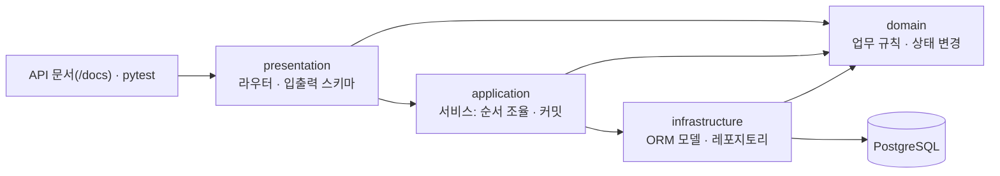
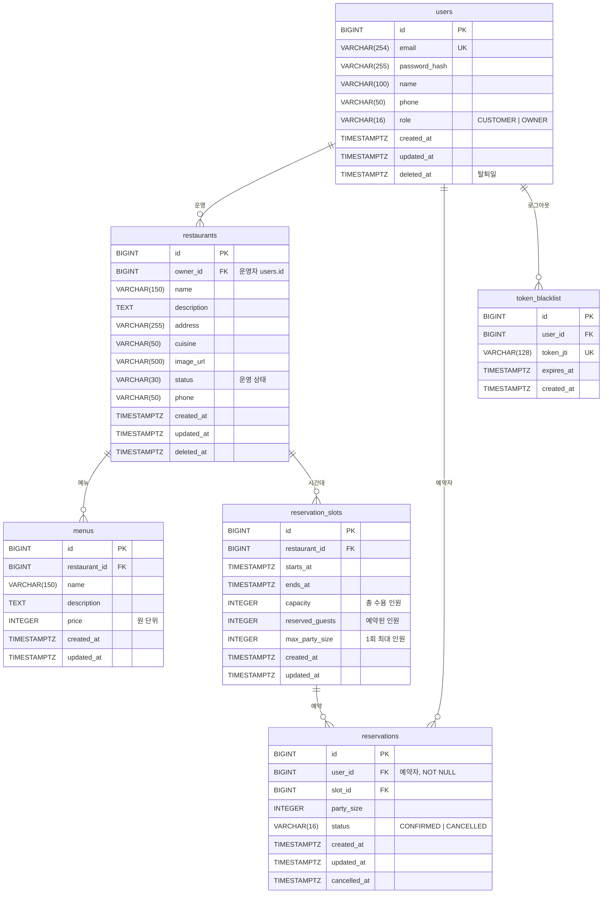

# 아키텍처와 API 설계

상태: 설계 확정, 구현 진행 중 (2026-10-28 개정: 5인 · 도메인 모듈 구조 · ERD 반영 · UI/CI/Redis 제외 · ERD 수정: 운영자 소속 → `restaurants.owner_id`, 예약 요청 중복 방지 테이블 삭제, 로그아웃 필수). 함께 볼 문서: [README](../README.md), [ROADMAP](ROADMAP.md), [WORKFLOW](WORKFLOW.md), [BACKEND_PLAN](BACKEND_PLAN.md), [TEAM_CONVENTIONS](TEAM_CONVENTIONS.md)

## 1. 요청 하나가 처리되는 흐름

코드는 **도메인(업무 주제)별 모듈**로 먼저 나누고, 각 모듈 안을 **4계층**으로 나눕니다.



화살표는 **코드를 참조하는 방향**입니다. `domain`은 아무것도 참조하지 않습니다.

| 계층 | 하는 일 | 하지 않는 일 | 주요 파일 |
| --- | --- | --- | --- |
| `presentation` | 요청 받기, Pydantic 입력 검증, 현재 사용자 확인, 결과를 응답 스키마로 변환 | SQL 작성, 업무 규칙 판단 | `router.py`, `schemas.py` |
| `application` | 레포지토리로 조회 → 도메인 규칙 실행 → 저장 → `commit()` | 규칙을 직접 계산, HTTP 응답 만들기 | `service.py` |
| `domain` | 순수 파이썬 객체(`dataclass`)와 업무 규칙, 규칙 위반 예외 | FastAPI · SQLAlchemy · Pydantic import | `<엔티티>.py`, `exceptions.py` |
| `infrastructure` | ORM 모델, 레포지토리(조회·저장, ORM 모델 ↔ 도메인 객체 변환) | `commit()` (서비스가 함) | `models.py`, `repository.py` |

**공통 실습 (D1~D3)**: 모두가 식당 상세 조회를 4계층으로 만듭니다. 라우터 → 서비스 → 레포지토리 → 도메인 `Restaurant` → 없으면 404. 처음에는 레포지토리를 메모리 리스트로 만들고, 그다음 DB 쿼리로 바꿉니다. **레포지토리만 바뀌고 다른 계층은 그대로**인 것을 직접 확인하는 것이 목표입니다.

용어 정리:
- **모듈**: `src/` 아래의 도메인 폴더 하나 (`user`, `restaurant` …). 같은 앱 안에서 코드를 나눈 단위이고, 따로 배포하는 서비스가 아님
- **도메인 객체**: DB를 모르는 순수 파이썬 객체. 업무 규칙과 상태 변경 메서드를 가짐
- **ORM 모델**: DB 테이블과 1:1로 대응하는 SQLAlchemy 클래스
- **레포지토리**: ORM 모델로 DB를 읽고 써서, 도메인 객체로 바꿔 돌려주는 클래스
- **서비스**: 하나의 유스케이스(예약하기, 취소하기)의 순서를 조율하고 트랜잭션을 확정
- **세션/트랜잭션**: 비동기 `AsyncSession` 하나가 요청 하나의 DB 작업을 묶음

## 2. 폴더 구조와 담당

```text
src/
├── main.py                  # 앱 생성, lifespan(테이블 생성 + 시드), 미들웨어, 라우터 등록
├── common/                  # 여러 모듈이 함께 쓰는 기반
│   ├── config.py            # 환경변수(.env) 읽기
│   ├── database.py          # 비동기 엔진, AsyncSession 의존성, ORM Base
│   ├── errors.py            # AppError 계열 예외 (순수 파이썬, 도메인에서도 사용)
│   ├── error_handlers.py    # 공통 에러 응답 형식으로 변환
│   ├── pagination.py        # Page[T] 목록 응답
│   └── middleware.py        # 요청 로그 · 처리 시간, CORS
├── user/                    # 담당 1
│   ├── domain/
│   ├── application/
│   ├── infrastructure/
│   └── presentation/
├── restaurant/              # 담당 2   (아래 모듈도 모두 같은 4계층)
├── slot/                    # 담당 3
├── reservation/             # 담당 4 (생성·취소) + 담당 5 (조회)
└── owner/                   # 담당 5 (운영자 조회 · 권한, 자기 테이블 없음)
```

모든 모듈·계층 패키지에 `__init__.py`를 둡니다.

| 모듈 | 담당 | 테이블 | 핵심 도메인 객체 |
| --- | --- | --- | --- |
| `common/`, `main.py` | `database.py`·`config.py`: 지원 작업 · 에러/페이지: 담당 2 · lifespan/시드: 담당 3 · 미들웨어: 담당 1 | — | `AppError` |
| `user` | 담당 1 | `users`, `token_blacklist` | `User` |
| `restaurant` | 담당 2 | `restaurants`, `menus` | `Restaurant`, `Menu` |
| `slot` | 담당 3 | `reservation_slots` | `TimeSlot` |
| `reservation` | 담당 4 · 담당 5 | `reservations` | `Reservation` |
| `owner` | 담당 5 | 없음 (`restaurants.owner_id`로 판단) | — |

`reservation` 모듈은 두 사람이 나눠 쓰므로 **파일 단위로 담당을 나눕니다** (쓰기 = 담당 4, 조회 = 담당 5).

| 파일 | 담당 |
| --- | --- |
| `domain/reservation.py`, `domain/exceptions.py` | 담당 4 |
| `application/service.py` (생성·취소) | 담당 4 |
| `infrastructure/models.py`, `infrastructure/repository.py` | 담당 4 |
| `presentation/schemas.py` (`ReservationCreate`, `ReservationOut`), `presentation/router.py` | 담당 4 |
| `application/query_service.py`, `infrastructure/query_repository.py`, `presentation/query_router.py` | 담당 5 |

`owner` 모듈은 **자기 테이블이 없는 조회·권한 모듈**입니다. 운영자 역할 검사 의존성(`require_owner`)과 운영자용 조회 API를 둡니다. `presentation`, `application`, `infrastructure`(다른 모듈 ORM 모델을 JOIN하는 조회 레포지토리)만 쓰고 `domain`은 비워 둡니다.

### 모듈 사이 참조 규칙

모듈 안에서는 1장의 계층 방향을 따릅니다. 다른 모듈의 코드는 아래 범위에서만 가져다 씁니다.

| 다른 모듈의 무엇을 | 허용 | 예 |
| --- | --- | --- |
| `domain` 객체 · 예외 | 허용 | 예약 서비스가 `TimeSlot.reserve()` 호출 |
| `application`의 조회 함수 (커밋하지 않음) | 허용 | `owner` 서비스가 `restaurant`의 식당 조회 함수 호출 |
| `infrastructure` 레포지토리 | **같은 트랜잭션이 꼭 필요할 때만**, 세션을 넘겨서 사용. 커밋은 호출한 서비스가 함 | 예약 서비스가 `slot` 레포지토리로 슬롯 행 락 |
| `infrastructure` ORM 모델 | FK 선언과 조회용 JOIN에만 | 예약 조회의 `reservations` ⋈ `reservation_slots` |
| `presentation` | 금지. 예외: 인증·권한 의존성 `user.presentation.dependencies.get_current_user`, `owner.presentation.dependencies.require_owner` | 식당 수정 API가 `require_owner` 사용 |

### DB 세션

- 모든 DB 작업은 비동기입니다 (`create_async_engine` + `asyncpg` + `AsyncSession`). 라우터와 서비스, 레포지토리 메서드는 `async def`입니다.
- 세션은 요청 하나당 하나만 씁니다 (`Depends(get_session)`). 한 세션을 `asyncio.gather` 등으로 동시에 쓰지 않습니다.
- `commit()`은 application 서비스에서만 합니다. 레포지토리는 id가 필요할 때 `flush()`까지만 합니다.
- 테이블은 앱 시작 시 lifespan에서 `Base.metadata.create_all`로 만듭니다. Alembic은 쓰지 않습니다 (7장).

> 현재 저장소에는 레이어를 먼저 나눈 골격(`src/domain/`, `src/application/` …)과 `src/infrastructure/database.py`(`AsyncConnection` 의존성)가 있습니다. 위 모듈 구조로 옮길 때 `database.py`는 `src/common/database.py`로 옮기고, ORM용 `AsyncSession` 의존성을 추가합니다.

## 3. 데이터 모델 (ERD)



| 테이블 | 용도 | 담당 | 범위 |
| --- | --- | --- | --- |
| `users` | 시드 계정 (비밀번호는 해시로 저장), 역할 `CUSTOMER`/`OWNER` | 담당 1 | 필수 |
| `restaurants` | 공개 식당 정보, 운영 상태, 운영자(`owner_id`) | 담당 2 | 필수 |
| `menus` | 식당별 메뉴와 가격 | 담당 2 | 필수 |
| `reservation_slots` | 시간대, 수용 인원, 예약된 인원, 1회 최대 인원 | 담당 3 | 필수 |
| `reservations` | 예약자, 슬롯, 인원, 상태, 시각 | 담당 4 | 필수 |
| `token_blacklist` | 로그아웃한 토큰(`jti`)을 만료까지 차단 | 담당 1 | 필수 |

**ERD 수정 (2026-10-28)**

- `restaurant_members` 삭제 → `restaurants.owner_id`(FK → `users.id`). 식당 하나에 운영자 한 명이고, 운영자 한 명은 식당 여러 개를 가질 수 있습니다(1:N). 그래서 JOIN 테이블 없이 FK 컬럼 하나로 충분합니다.
- `idempotency_records` 삭제. 재시도 중복은 6장의 중복 예약 규칙으로 일부 막고, 남는 경우는 한계로 설명합니다.
- `reservations.user_id`는 NOT NULL을 유지합니다. 예약 행은 예약이 확정될 때만 INSERT하므로 예약자가 없는 예약은 존재하지 않습니다. "예약 가능"은 예약 행이 아니라 슬롯의 `capacity − reserved_guests`로 판단합니다. 빈 예약 행을 미리 만들어 두고 `user_id`를 채우는 방식은 쓰지 않습니다.

ERD에 더해 아래 제약을 모델에 선언합니다. 해당 테이블 담당이 이유를 설명할 수 있어야 합니다.

- 모든 FK에 외래 키 제약, `owner_id`·`restaurant_id`·`user_id`·`slot_id`에 인덱스
- `restaurants.owner_id`, `reservations.user_id`, `token_blacklist.user_id`는 NOT NULL
- `users.email` UNIQUE, `token_blacklist.token_jti` UNIQUE (요청마다 이 컬럼으로 조회하므로 인덱스 역할도 함)
- `menus.price >= 0`
- `reservation_slots`: `0 <= reserved_guests <= capacity`, `max_party_size >= 1`, `starts_at < ends_at`, 인덱스 `(restaurant_id, starts_at)`
- `reservations`: `party_size >= 1`, `status IN ('CONFIRMED', 'CANCELLED')`

타입 대응: `BIGINT` PK → `BigInteger` 자동 증가, `TIMESTAMPTZ` → `DateTime(timezone=True)`. `deleted_at`은 소프트 삭제 표시입니다. 값이 있는 행은 공개 조회에서 빼고, 삭제·탈퇴 API는 만들지 않습니다.

**시드 데이터** (lifespan에서 넣음, 20건 이상): 식당 3곳(서로 다른 `cuisine`), 메뉴 9개, 고객 2명, 운영자 2명(운영자 A는 식당 2곳, 운영자 B는 1곳을 `owner_id`로 소유), 슬롯 12개 이상(열린 슬롯, 꽉 찬 슬롯, `max_party_size`가 작은 슬롯 포함). 슬롯 시각은 시드를 넣는 날 기준 **앞으로의 날짜**로 계산하고, 한 식당 안에서 겹치지 않게 합니다. 재시작할 때는 이미 시드가 있으면(예: 시드 이메일 존재) 건너뜁니다.

## 4. 예약 규칙

- 슬롯은 고정 시간대 `[starts_at, ends_at)`이고, 한 식당 안에서 겹치지 않음 (시드로 보장, DB 제약은 두지 않음)
- 수용 인원은 테이블 수가 아니라 손님 수 기준
- 인원은 1명 이상이고 슬롯의 `max_party_size` 이하
- 시작 시각이 지난 슬롯은 예약할 수 없음
- 남은 자리(`capacity − reserved_guests`)보다 많은 인원은 예약할 수 없음
- 같은 사용자가 같은 슬롯에 `CONFIRMED` 예약을 두 개 가질 수 없음
- 예약은 바로 확정. 결제, 임시 홀드, 승인, 일정 변경 없음. 상태는 `CONFIRMED`, `CANCELLED` 두 가지
- 취소는 예약자 본인만, 슬롯 시작 전까지만. 취소하면 `cancelled_at`을 기록하고 좌석을 복구
- 이미 취소한 예약은 다시 취소할 수 없음 (409, 좌석도 다시 복구하지 않음)
- 고객은 자기 예약만, 운영자는 자기 식당(`owner_id`)의 예약만 봄. 운영자는 고객 예약을 취소하지 않음
- 운영자 계정과 식당 소유(`owner_id`)는 시드로만 만듦. 일반 요청으로 권한을 얻을 수 없음
- 시각은 타임존 포함으로 저장. 날짜 필터와 "하루"의 기준은 **Asia/Seoul 고정** (ERD에 식당별 타임존 컬럼 없음). 가격은 원 단위 정수
- 예약 오픈 시각 규칙은 두지 않음 (ERD에 컬럼 없음)

규칙은 **도메인 객체 안에** 둡니다. 서비스는 순서만 조율하고, 규칙을 직접 계산하지 않습니다.

| 규칙 | 위치 | 위반 시 |
| --- | --- | --- |
| 시작 전 · 1회 최대 인원 · 남은 자리 | `slot/domain/time_slot.py` — `TimeSlot.can_accept()`, `TimeSlot.reserve()` | 409 `SLOT_ALREADY_STARTED` / `PARTY_SIZE_EXCEEDED` / `SLOT_SOLD_OUT` |
| 취소 시 좌석 복구 | `TimeSlot.release()` | — |
| 중복 예약 | 예약 서비스가 레포지토리로 확인 → 도메인 예외 | 409 `DUPLICATE_RESERVATION` |
| 취소 가능 여부 | `reservation/domain/reservation.py` — `Reservation.cancel()`, `Reservation.can_cancel()` | 409 `ALREADY_CANCELLED` / `CANCELLATION_NOT_ALLOWED` |

예약 가능 조회(담당 3)와 예약 생성(담당 4)은 같은 `TimeSlot.can_accept()`를 씁니다. 그래서 "조회에서는 가능하다고 나왔는데 예약은 다른 기준으로 거절"되는 일이 없습니다.

## 5. API와 담당

모든 비즈니스 경로는 `/api/v1`로 시작합니다.

| 담당 | 모듈 | 메서드와 경로 | 핵심 포인트 |
| --- | --- | --- | --- |
| 1 | `user` | `POST /auth/login` | OAuth2 폼(`username`=이메일, `password`), 토큰 발급 |
| 1 | `user` | `GET /users/me` | 현재 사용자 의존성 |
| 1 | `user` | `POST /auth/logout` | 현재 토큰의 `jti`를 블랙리스트에 저장, 204 |
| 2 | `restaurant` | `GET /restaurants` | 검색(`q`) · 필터(`cuisine`) · 정렬(`sort`) · 페이지(`page`/`page_size`) |
| 2 | `restaurant` | `GET /restaurants/{id}` | 상세 + 메뉴, 404 |
| 2 | `restaurant` | `PATCH /owner/restaurants/{id}` | 허용된 필드만 수정, 역할·소유 확인 |
| 3 | `slot` | `GET /restaurants/{id}/availability` | `date`, `party_size`, `TimeSlot.can_accept()` |
| 4 | `reservation` | `POST /reservations` | `slot_id`/`party_size`, 행 락 트랜잭션 |
| 4 | `reservation` | `POST /reservations/{id}/cancel` | 상태 전환, 좌석 복구 |
| 5 | `reservation` | `GET /users/me/reservations` | 로그인한 사용자의 예약 목록 |
| 5 | `reservation` | `GET /reservations/{id}` | 본인 예약이거나 해당 식당 운영자일 때만 |
| 5 | `owner` | `GET /owner/restaurants` | 현재 운영자가 소유한 식당 (`WHERE owner_id = 나`) |
| 5 | `owner` | `GET /owner/restaurants/{id}/reservations` | 소유 확인 후 그 식당의 예약, 날짜 필터(선택) |

경로 접두어와 모듈은 다를 수 있습니다. 예를 들어 `/restaurants/{id}/availability`는 슬롯 규칙을 쓰므로 `slot` 모듈에 둡니다. `PATCH /owner/restaurants/{id}`는 식당 정보를 바꾸므로 `restaurant` 모듈에 둡니다.

선택 과제 API(`POST /auth/signup`)는 필수 흐름이 다 돌아간 뒤에 추가합니다.

## 6. 보안과 트랜잭션

**인증**: 비밀번호는 검증된 해시 라이브러리로 저장하고 비교합니다 (README 기술 스택). 암호화 로직을 직접 만들지 않습니다. 토큰은 PyJWT로 만든 짧은 수명의 Bearer JWT입니다. `sub`=사용자 id, `exp`, `jti`를 넣습니다. 로그인은 `OAuth2PasswordRequestForm`(폼 전송)으로 받습니다. 그래서 `/docs`의 **Authorize** 버튼으로 바로 로그인해서 다른 API를 시험할 수 있습니다.

**로그아웃 (블랙리스트)**: JWT는 서버가 저장하지 않습니다. 그래서 아무것도 하지 않으면 로그아웃한 토큰도 만료 전까지 그대로 쓸 수 있습니다. `POST /auth/logout`은 현재 토큰의 `jti`와 `exp`를 `token_blacklist`에 저장하고 204를 돌려줍니다. `get_current_user`는 아래 순서로 검사합니다.

1. 서명·만료 검사 (DB 없이 계산만). 실패하면 401
2. `token_jti`로 블랙리스트 조회. 있으면 401
3. 사용자 조회. 없거나 `deleted_at`이 있으면 401

블랙리스트는 PostgreSQL 테이블이고 Redis를 쓰지 않습니다. 만료된 행(`expires_at < now()`)은 앱 시작 때 lifespan에서 지웁니다. 블랙리스트는 로그아웃한 그 토큰 하나만 막고, 다른 기기에서 받은 토큰까지 막지는 않습니다.

**운영자 권한 (2단계)**: 운영자 API는 역할과 소유를 차례로 확인합니다.

| 단계 | 확인 | 실패 시 | 위치 |
| --- | --- | --- | --- |
| 1. 역할 | `role == OWNER` | 403 | `owner/presentation/dependencies.py` — `require_owner` (모든 `/owner/*` 라우트에 적용) |
| 2. 소유 | `restaurant.owner_id == 현재 사용자 id` | 403 | `restaurant/domain/restaurant.py` — `Restaurant.is_owned_by(user_id)` |

FK는 "그 id의 사용자가 존재한다"만 보장하고 역할은 확인하지 않습니다. 그래서 1단계를 따로 둡니다. 운영자 식당 목록(`GET /owner/restaurants`)은 `WHERE owner_id = 나` 조건 자체가 2단계 검증입니다. 남의 식당은 404로 숨기지 않고 403을 돌려줍니다. 식당은 `GET /restaurants/{id}`로 누구나 존재를 알 수 있기 때문입니다. 반대로 남의 예약은 존재 자체가 개인 정보라서 404로 숨깁니다.

**예약 생성**은 서비스가 아래를 **한 트랜잭션 안에서** 처리합니다.

1. 슬롯 행을 락 걸고 읽기 (`slot` 레포지토리, `SELECT … FOR UPDATE`)
2. 같은 사용자·같은 슬롯의 `CONFIRMED` 예약이 있는지 확인
3. `TimeSlot.reserve(party_size, now)`: 규칙 검사 후 `reserved_guests` 증가
4. `Reservation` 생성 → 예약 저장, 슬롯 변경 저장
5. `commit()`. 중간에 실패하면 전부 롤백

슬롯 행 락을 잡은 상태에서 2번을 확인하므로, 같은 슬롯에 대한 중복 확인도 한 번에 한 요청씩만 진행됩니다.

**취소**: 예약을 읽어 본인인지 확인합니다(아니면 404). 그다음 슬롯 행 락 → 예약 행 락 순서로 잡고 상태를 다시 확인합니다. `Reservation.cancel(now, slot)` → `TimeSlot.release()` → `commit()` 순서로 처리합니다. 모든 쓰기 경로에서 **락 순서는 항상 슬롯 → 예약**으로 같게 해서 교착 상태를 피합니다.

담당 4가 설명할 수 있어야 하는 것:
- 왜 두 요청이 같은 남은 자리를 볼 수 있는지
- 트랜잭션이 무엇을 하나로 묶는지
- 행 락을 걸면 동시에 들어온 요청 중 왜 하나만 성공하는지

행 락 코드는 기본 구현에 넣습니다. **동시 요청을 실제로 재현하는 테스트는 선택 과제**입니다. 할 때는 서로 독립된 PostgreSQL 연결(세션 두 개)로 겹치게 실행합니다. 순차 요청, 목, Python 락으로는 DB 동시성을 검증할 수 없습니다. 참고: [PostgreSQL 행 락](https://www.postgresql.org/docs/current/explicit-locking.html#LOCKING-ROWS)

**재시도 중복**: 예약 요청 중복 방지 테이블(`idempotency_records`)은 ERD에서 뺐습니다. 같은 사용자가 같은 슬롯에 두 번 예약되는 것은 중복 예약 규칙(409 `DUPLICATE_RESERVATION`)이 막습니다. 네트워크 오류 뒤 재시도하면서 다른 슬롯에 예약되는 경우는 시연 때 한계로 설명합니다.

## 7. 범위에서 뺀 것

| 항목 | 결정 | 대신 |
| --- | --- | --- |
| UI (Jinja2 화면, 프론트 연결) | 제외 (2026-10-28) | API 문서 화면(`/docs`)과 pytest로 확인 |
| CI | 제외 (2026-10-28) | PR 전에 로컬에서 테스트, 실행 결과를 PR에 기록 |
| Redis 캐시 | 제외 (2026-10-28) | 모든 조회를 PostgreSQL에서 바로 읽음 |
| Alembic 마이그레이션 | 제외 (2026-10-28) | lifespan `create_all`. 스키마가 바뀌면 로컬 DB를 다시 만듦 |
| 회원가입 | 선택 과제 (담당 1) | 시드 계정으로 로그인 |
| 예약 요청 중복 방지 (멱등성) | 제외 — ERD에서 테이블 삭제 (2026-10-28) | 같은 슬롯 중복 예약 규칙 |
| 한 식당을 운영자 여러 명이 공동 운영 | 제외 — `restaurant_members` 삭제 (2026-10-28) | 식당 하나에 운영자 한 명 (`owner_id`) |
| 동시성 재현 테스트 | 선택 과제 (담당 4) | 행 락 코드 + 순차 테스트 |
| 예약 오픈 시각 | 제외 (ERD에 컬럼 없음) | 슬롯 시작 전이면 예약 가능 |
| 외부 배포 | 제출 조건일 때만 | 로컬 데모 |

Docker Compose는 로컬 PostgreSQL을 띄우는 데만 씁니다. DB 장애는 "결과 없음"으로 성공 처리하지 않고 그대로 장애로 응답합니다(503).
